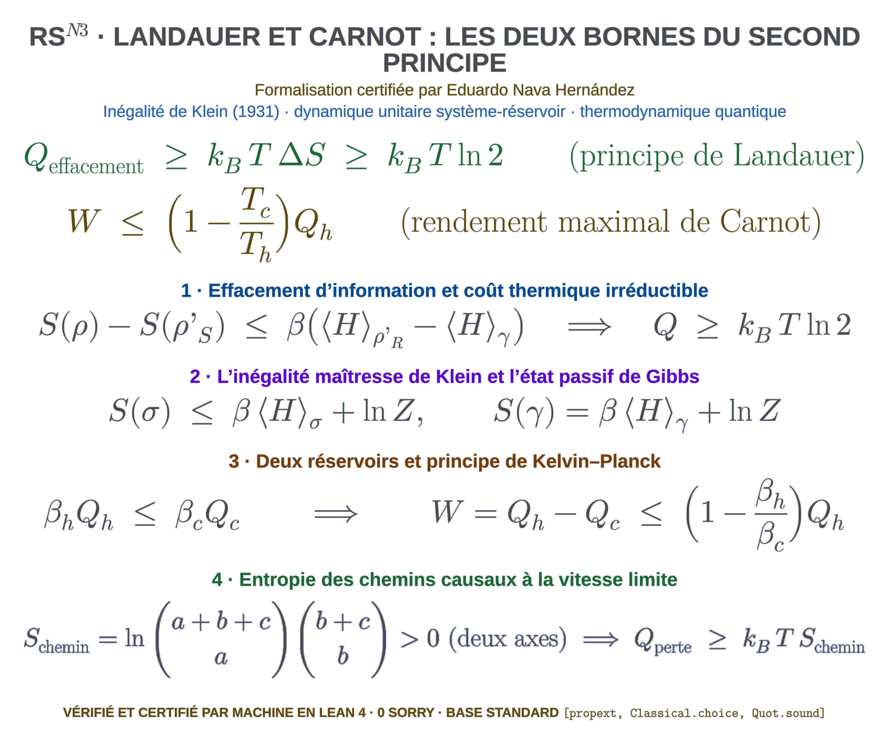
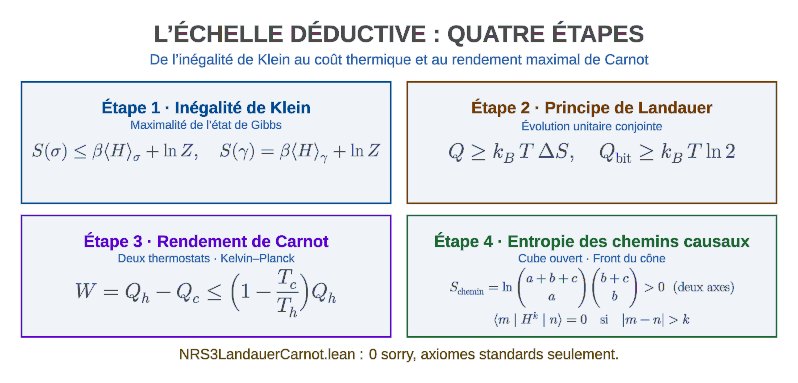
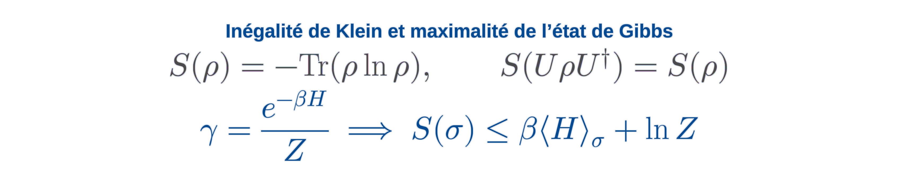
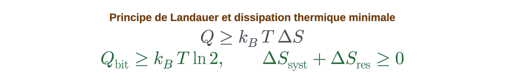
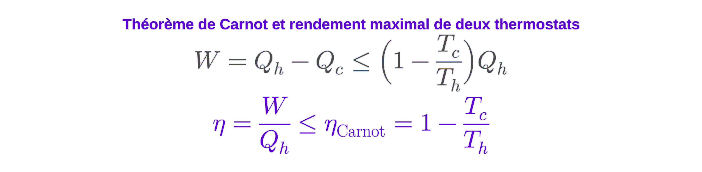
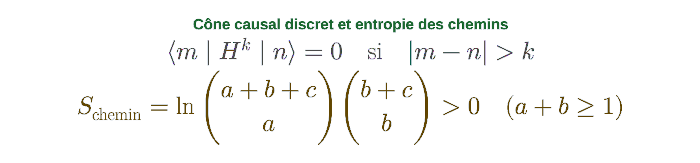

<div align="center">

# RS<sup>N</sup>³ · Landauer et Carnot
### Le second principe comme borne spectrale : effacer un bit coûte au moins k_B T ln 2 et aucune machine ne dépasse Carnot

**Eduardo Nava Hernández**  
*Vérification formelle certifiée en Lean 4 · 0 sorry · Physlib (QuantumInfo)*

[](https://leanprover.github.io/)
[](https://github.com/leanprover-community/mathlib4)
[](Verification/Axioms.lean)
[](https://github.com/leanprover-community/physlib/pulls?q=is%3Apr+is%3Amerged+author%3Anaype888-cloud)
[](https://naype888-cloud.github.io/nrs3-landauer-carnot/)

**[▶ Essayer en ligne : Effacer un bit sur une chaîne de d sites](https://naype888-cloud.github.io/nrs3-landauer-carnot/)** · **[▶ Moteurs de Carnot entre deux chaînes](https://naype888-cloud.github.io/nrs3-landauer-carnot/carnot.html)**

</div>

---

> ### 🏛️ Ce qui distingue le théorème : Klein unifie Landauer et Carnot
>
> Le second principe de la thermodynamique émerge ici non pas comme un postulat statistique macroscopique, mais comme une conséquence déductive exacte de l'inégalité de Klein pour l'état d'équilibre canonique de Gibbs sous évolution unitaire conjointe.
>
> <div align="center">
> <picture><source media="(prefers-color-scheme: dark)" srcset="assets/oscuro/plaque_landauer_carnot_master.png"></picture>
> </div>
>
> **1 · Coût thermique de l'effacement.** Un système qui perd une entropie `ΔS` au profit d'un réservoir à température `T` lui cède nécessairement une chaleur `Q ≥ k_B T ΔS`. Pour un bit d'information, `Q ≥ k_B T ln 2`.
>
> **2 · Borne de Carnot universelle.** Entre deux réservoirs thermiques à T_h et T_c, le travail extrait vérifie W ≤ (1 − T_c / T_h) Q_h. Un réservoir unique ne peut fournir aucun travail (principe de Kelvin–Planck).
>
> **3 · Inégalité maîtresse de Klein.** L'état de Gibbs `γ = exp(−βH) / Z` possède l'entropie maximale parmi tous les états de même énergie moyenne, et sa passivité unitaire interdit toute extraction spontanée d'énergie.
>
> **4 · Entropie des chemins à la vitesse limite.** Sur le cube ouvert à vitesse limite, le nombre de chemins causaux `C(a + b + c, a) C(b + c, b)` génère une entropie non nulle dès que deux axes sont actifs : effacer la trajectoire libère une chaleur irréductible.

---

## ⚡ Résumé formel

* L'état canonique de Gibbs `γ = exp(−βH) / Z` sature l'inégalité de Klein `S(γ) = β ⟨H⟩_γ + log Z`, tandis que tout autre état vérifie `S(σ) ≤ β ⟨H⟩_σ + log Z` : [`NRS3LandauerCarnot/Landauer.lean`](NRS3LandauerCarnot/Landauer.lean) (`Sᵥₙ_gibbsState`, `Sᵥₙ_le_gibbs`).
* Sous toute transformation unitaire `U` couplant le système et le réservoir, la variation d'entropie borne le transfert thermique : `S(ρ) − S(ρ′_S) ≤ β (⟨H⟩_{ρ′_R} − ⟨H⟩_γ)` : [`NRS3LandauerCarnot/Landauer.lean`](NRS3LandauerCarnot/Landauer.lean) (`landauer`, `landauer_temperature`).
* L'effacement d'un bit logique (`ΔS = log 2`) dissipe au minimum `k_B T log 2` : [`NRS3LandauerCarnot/Landauer.lean`](NRS3LandauerCarnot/Landauer.lean) (`landauer_bit`).
* Pour un réservoir unique, aucun travail ne peut être extrait de l'état thermique (`⟨H⟩_γ ≤ ⟨H⟩_{U γ U†}`) : [`NRS3LandauerCarnot/Carnot.lean`](NRS3LandauerCarnot/Carnot.lean) (`inner_gibbsState_le_uConj`).
* Entre deux réservoirs, l'efficacité est rigoureusement bornée par le facteur de Carnot W ≤ (1 − T_c / T_h) Q_h : [`NRS3LandauerCarnot/Carnot.lean`](NRS3LandauerCarnot/Carnot.lean) (`carnot`, `carnot_temperature`).
* Sur le réseau cubique, les chemins atteignant le cône de lumière déploient une entropie combinatoire strictement positive dès que deux directions bougent : [`NRS3LandauerCarnot/PathEntropy.lean`](NRS3LandauerCarnot/PathEntropy.lean) (`card_lightPath`, `pathEntropy_pos`, `landauer_pathEntropy`).
* Sur la chaîne de saut ouverte, le front du paquet d'ondes avance à vitesse finie `⟨m| H^k |n⟩ = 0` pour `|m − n| > k`, bornant strictement la causalité : [`NRS3LandauerCarnot/LightCone.lean`](NRS3LandauerCarnot/LightCone.lean) (`inner_pow_openHamiltonian_eq_zero`, `event_window`).

---

## 📐 Démonstration constructive en quatre étapes

<div align="center">
<picture><source media="(prefers-color-scheme: dark)" srcset="assets/oscuro/plaque_landauer_carnot_etapes.png"></picture>
</div>

### Étape 1 : L'inégalité de Klein et la passivité de Gibbs

> **Proposition 1.1 (Sous-additivité et maximalité de Gibbs).** L'entropie de von Neumann est invariante par conjugaison unitaire `S(U ρ U†) = S(ρ)` et additive sur les produits tensoriels `S(ρ ⊗ σ) = S(ρ) + S(σ)`. L'état thermique de Gibbs maximise l'entropie à énergie fixée.

<div align="center"><picture><source media="(prefers-color-scheme: dark)" srcset="assets/oscuro/plaque_landauer_carnot_etape1.png"></picture></div>

*Module formel :* [`NRS3LandauerCarnot/Landauer.lean`](NRS3LandauerCarnot/Landauer.lean) (`Sᵥₙ_prod`, `Sᵥₙ_uConj`, `Sᵥₙ_le_gibbs`).

---

### Étape 2 : Le principe de Landauer et le coût de l'information

> **Proposition 2.1 (Borne thermique de Landauer).** L'effacement d'une quantité d'information `ΔS` dans un réservoir thermique à température `T` impose un transfert de chaleur `Q ≥ k_B T ΔS`.

<div align="center"><picture><source media="(prefers-color-scheme: dark)" srcset="assets/oscuro/plaque_landauer_carnot_etape2.png"></picture></div>

*Module formel :* [`NRS3LandauerCarnot/Landauer.lean`](NRS3LandauerCarnot/Landauer.lean) (`landauer`, `landauer_temperature`, `landauer_bit`).

---

### Étape 3 : Théorème de Carnot et principe de Kelvin–Planck

> **Proposition 3.1 (Rendement universel de Carnot).** Aucun cycle thermique couplé à deux thermostats ne peut dépasser l'efficacité réversible de Carnot 1 − T_c / T_h.

<div align="center"><picture><source media="(prefers-color-scheme: dark)" srcset="assets/oscuro/plaque_landauer_carnot_etape3.png"></picture></div>

*Module formel :* [`NRS3LandauerCarnot/Carnot.lean`](NRS3LandauerCarnot/Carnot.lean) (`inner_gibbsState_le_uConj`, `carnot_entropy`, `carnot`, `carnot_temperature`).

---

### Étape 4 : Cône causal et entropie géométrique des chemins

> **Proposition 4.1 (Confinement du cône de lumière).** Le transport discret sur le graphe chemin interdit toute propagation plus rapide qu'un saut par unité de temps : `⟨m| H^k |n⟩ = 0` si `|m − n| > k`.

<div align="center"><picture><source media="(prefers-color-scheme: dark)" srcset="assets/oscuro/plaque_landauer_carnot_etape4.png"></picture></div>

*Module formel :* [`NRS3LandauerCarnot/LightCone.lean`](NRS3LandauerCarnot/LightCone.lean) (`inner_pow_openHamiltonian_eq_zero`, `inner_pow_openHamiltonian_front`, `event_window`).  
*Module formel (chemins) :* [`NRS3LandauerCarnot/PathEntropy.lean`](NRS3LandauerCarnot/PathEntropy.lean) (`card_lightPath`, `pathEntropy_pos`, `landauer_pathEntropy`).

---

## 🔬 Contributions Physlib fusionnées liées

| PR Physlib | Titre | Lien avec ce dépôt | Statut |
|:---:|:---|:---|:---:|
| [**#1689**](https://github.com/leanprover-community/physlib/pull/1689) | tight binding chain with open boundary conditions | `LightCone.lean` importe la chaîne ouverte et son hamiltonien, étape 4 | **MERGED** |
| [**#2096**](https://github.com/leanprover-community/physlib/pull/2096) | the open tight binding chain is the hopping of the path graph | Le saut de la chaîne ouverte est l'adjacence du graphe chemin : `⟨m|H^k|n⟩` ne voit que les chemins de longueur `k`, étape 4 | **MERGED** |

---

## 📚 Catalogue des modules Lean

| Module | Théorème principal | Signification | `sorry` |
|:---|:---|:---|:---:|
| [`NRS3LandauerCarnot/Landauer.lean`](NRS3LandauerCarnot/Landauer.lean) | `landauer_bit` | Effacer un bit coûte au moins `k_B T log 2` | 0 |
| [`NRS3LandauerCarnot/Equilibrium.lean`](NRS3LandauerCarnot/Equilibrium.lean) | `gibbsState_end_of_count` | L'état de Gibbs maximise l'entropie à énergie moyenne fixée | 0 |
| [`NRS3LandauerCarnot/Carnot.lean`](NRS3LandauerCarnot/Carnot.lean) | `carnot_temperature` | `W ≤ (1 − T_c / T_h) Q_h` | 0 |
| [`NRS3LandauerCarnot/LightCone.lean`](NRS3LandauerCarnot/LightCone.lean) | `inner_pow_openHamiltonian_eq_zero` | Cône de lumière : `⟨m|H^k|n⟩ = 0` pour `|m − n| > k` | 0 |
| [`NRS3LandauerCarnot/PathEntropy.lean`](NRS3LandauerCarnot/PathEntropy.lean) | `landauer_pathEntropy` | Effacer le chemin suivi coûte au moins `k_B T` fois son entropie | 0 |

### Portée

* Le système et le réservoir sont de dimension finie ; l'interaction est un unitaire sur `ρ ⊗ γ`. La limite thermodynamique n'est pas traitée.
* Le moteur de Carnot est un cycle à deux réservoirs de Gibbs ; aucune dynamique en temps continu n'est formalisée.

---

## 🏛️ La mosaïque

| Dépôt | Objet |
|:---|:---|
| [**nava-robertson-schrodinger**](https://github.com/naype888-cloud/nava-robertson-schrodinger) | Le canon : l'incertitude élémentaire dimensionnelle sur le cube ouvert |
| [`lean4-commits`](https://github.com/naype888-cloud/lean4-commits) | Les PRs Lean 4 fusionnées et ouvertes dans Physlib |
| [`Proper-Time-General-Relativity`](https://github.com/naype888-cloud/Proper-Time-General-Relativity) | Le temps compte les pas à quatre sites |
| [`nrs3-golab`](https://github.com/naype888-cloud/nrs3-golab) | Le π d'un plan normé et la stabilité des orbites |
| [`nrs3-mandelstam-tamm-cramer-rao`](https://github.com/naype888-cloud/nrs3-mandelstam-tamm-cramer-rao) | Vitesse d'évolution et borne d'estimation de phase |
| [`nrs3-de-sitter`](https://github.com/naype888-cloud/nrs3-de-sitter) | L'entropie d'horizon fixe la constante cosmologique ; les deux équations de Friedmann |
| [`nrs3-penrose`](https://github.com/naype888-cloud/nrs3-penrose) | Le temps d'effondrement ħ/ΔE est une borne, non une durée de vie |
| [`nrs3-bekenstein`](https://github.com/naype888-cloud/nrs3-bekenstein) | Bits sur la frontière, fibre de Minkowski et borne universelle |
| [`nrs3-rovelli-lqg`](https://github.com/naype888-cloud/nrs3-rovelli-lqg) | Le spectre d'aire LQG, les piqûres d'horizon et le paramètre d'Immirzi |
| [`nrs3-uncertainty-cone`](https://github.com/naype888-cloud/nrs3-uncertainty-cone) | La matrice de Gram d'une paire conjuguée est un quadrivecteur de Minkowski |

---

## ⏱️ Chronologie

| Année | Résultat | Étape |
|:---:|:---|:---:|
| **1824** | Carnot : le rendement maximal entre deux sources | 3 |
| **1851** | Kelvin : la chaleur d'une seule source ne donne pas de travail | 3 |
| **1902** | Gibbs : l'ensemble canonique e^(−βH) / Z | 1 |
| **1931** | Klein : l'inégalité de Klein | 1 |
| **1961** | Landauer : effacer un bit coûte k_B T ln 2 | 2 |

---

## 🛠️ Compilation et vérification

```bash
lake exe cache get
lake build
lake env lean Verification/Axioms.lean
```

Le module compile sous la base axiomatique standard de Lean 4 et Mathlib :

```text
[propext, Classical.choice, Quot.sound]
```

**0 `sorry`**, aucun axiome ad hoc.

---

## 📜 Licence

[NRS Noncommercial License 1.0.0](LICENSE).

---

<div align="center">

### 🌌 *« Effacer une trace dans la mémoire du monde exige de payer un tribut thermique irréductible : l'entropie ne s'éteint jamais sans réchauffer le réservoir. »*

**Eduardo Nava Hernández** · naype888@gmail.com · [naype888-cloud](https://github.com/naype888-cloud)

</div>
